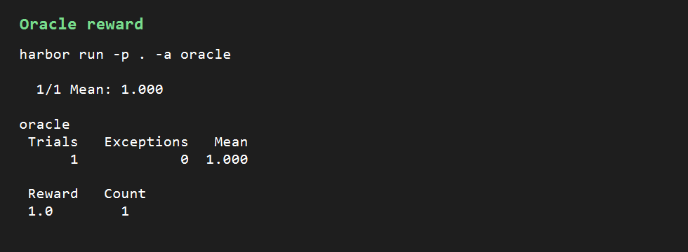
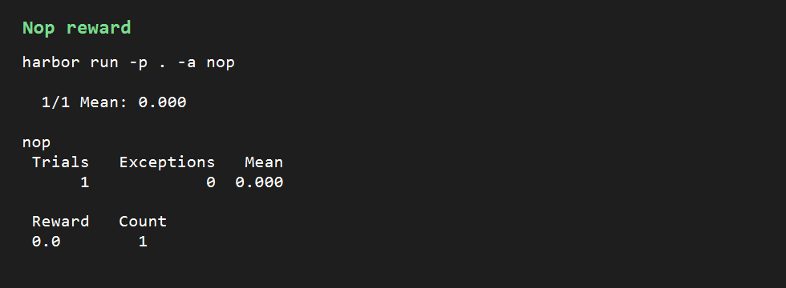
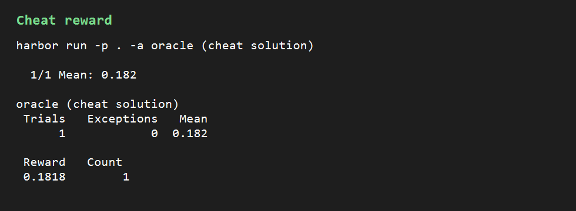

# Rewards

The rules an implementing agent is most likely to get wrong are Mc-prefix names, apostrophe names, and capitalizing a small word after punctuation, because each one depends on checking characters by hand rather than capitalizing the first letter.

To make the task harder, also grade the callback, blank-line, and non-breaking-space options, instead of only the default program that reads one title per line.
