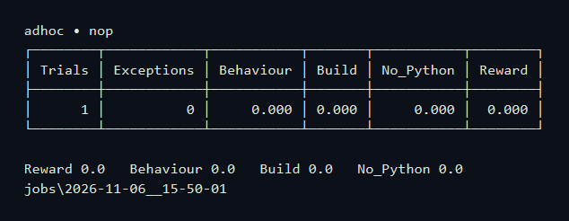
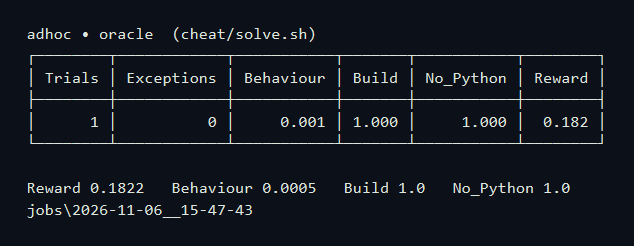

# KanishkaSharma/titlecase-go

The agent did not miss titlecase rules; the repeated failure was `go build ./...`, because the leftover `titlecase/` directory has the same name as the binary Go writes.
To make the task harder, also require the callback, `preserve_blank_lines`, and `normalise_space_characters` options, and grade whole multi-line titles on the Unicode `regex` path.

## Rewards

Oracle **1.0**. Nop **0.0**. Cheat **0.182**.

### Oracle

### Nop

### Cheat

